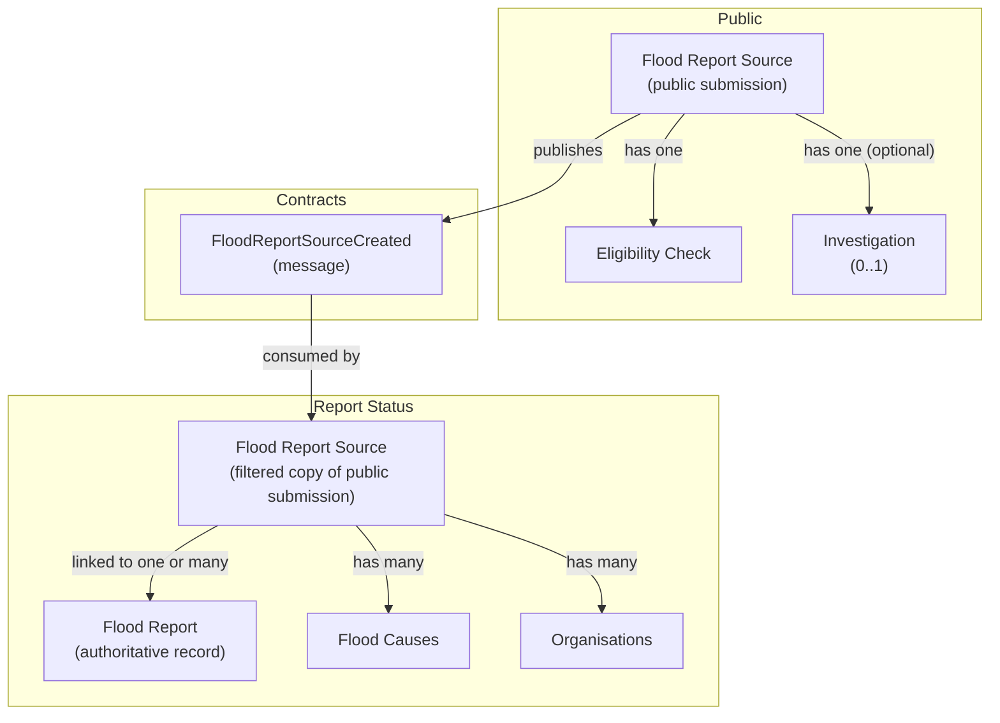
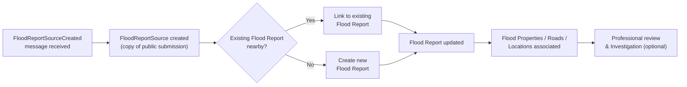

# Overview

## System Context

Two systems work together to manage flood reporting:

- **Public** — the public-facing tool where members of the public submit flood reports. Each submission is a *Flood Report Source*; it is the raw, unverified data provided by a reporter.
- **Report Status** — the professional back-office tool used by flood risk colleagues. It receives flood report sources and creates and manages the authoritative *Flood Report* — the single version of the truth for a discrete flooding event.

> **Naming note:** The term "Flood Report" means different things in each system. In the Public system it was historically called a Flood Report, but it is better understood as a *Flood Report Source* — a submission that may or may not correspond to a real flooding event. In Report Status, *Flood Report* is the authoritative record.

---

## System Relationships

## Flood Report Lifecycle (Report Status)

---

## Key Entities — Report Status

| Entity | Cardinality | Description |
|---|---|---|
| `FloodReport` | — | The authoritative record of a flooding event |
| `FloodReportSource` | many per `FloodReport` | A public submission that contributed to this flood report |
| `Investigation` | 0..1 per `FloodReport` | A formal investigation by a flood risk officer |
| `FloodProperty` | many per `FloodReport` | A residential or commercial property affected |
| `FloodRoad` | many per `FloodReport` | A road affected |
| `FloodLocation` | many per `FloodReport` | A general geographic location affected |
