```mermaid
sequenceDiagram
    participant L as 
    participant Public
    participant ASB as Azure Service Bus
    participant RS as Report Status
    participant RM as Risk Manager
    participant R as 


    rect rgb(0, 0, 0)
        Note over L,R: New Reports
        Public->>ASB: FloodReportSourceCreated (1)
        ASB->>RS: Reads FloodReportSourceCreated (2)
        alt Duplicate report detected
            RS->>RS: Attach FloodReportSource to existing FloodReport
        else New report
            RS->>RS: Generate FloodReport with FloodReportSource attached
        end
        Note over RS: FloodReport created or updated
        RS->>ASB: FloodReportCreated (3)
    end 

    rect rgb(0, 0, 0)
        Note over L,R: Report Update
        Public->>ASB: FloodReportSourceUpdated (1)
        ASB->>RS: Read FloodReportSourceUpdated (2)
        Note over RS: Record updated
        RS->>ASB: FloodReportSourceUpdated (3)
    end

    rect rgb(0, 0, 0)
        Note over L,R: Report Triggers
        RM->>ASB: Various trigger messages (1)
        ASB->>RS: Reads messages (2)
        Note over RS: Update report status based on triggers
        RS->>ASB: Various triggers to public (3)
        ASB->>Public: Reads trigger (4)
        Note over Public: Notify users based on triggers
    end
```

## Notes

- This application also has an API that allows the other modules to search for flood reports and their statuses. This communication is not included in the diagram above. 
- Report status operates on `Flood Reports` but public operates on `Flood Report Sources`. This means a single trigger from risk manager to a specific `Flood Report` may result in multiple `Flood Report Sources` being updated and multiple notifications to the public.
